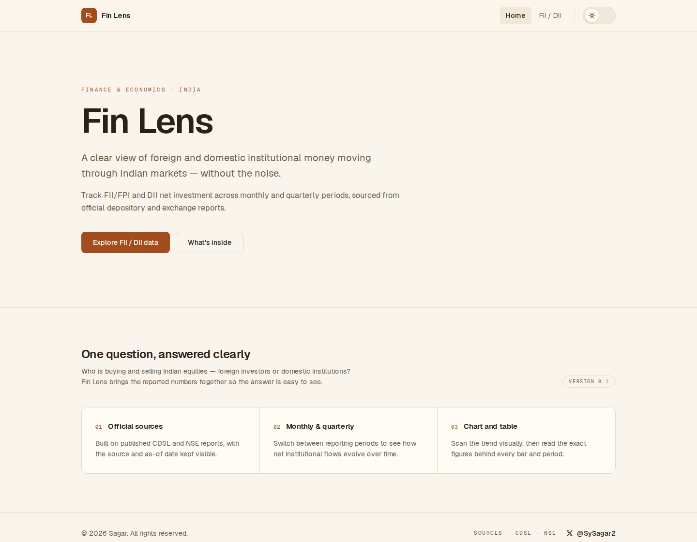
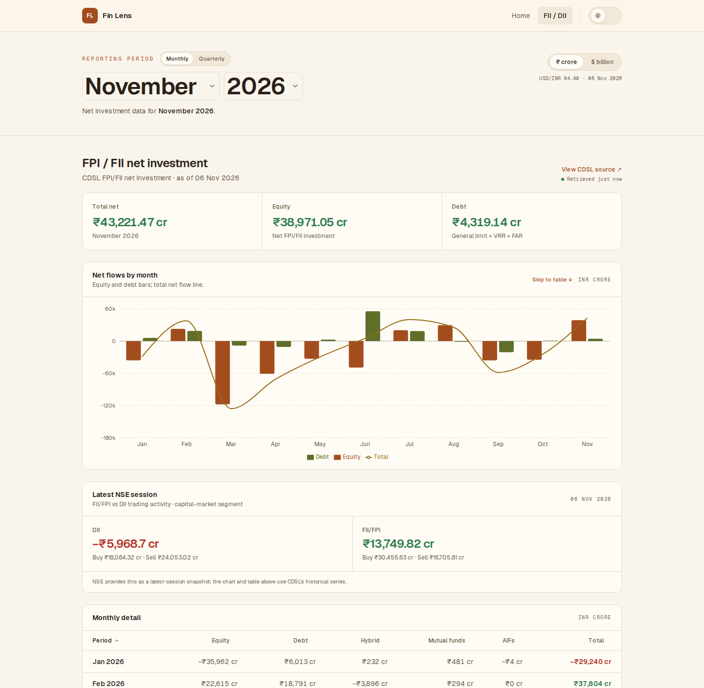

# Fin Lens

**A clear view of economy and investments in Indian markets — without the noise.**

Fin Lens can be installed on a phone from its browser. On Android, choose
**Install app** in the footer (or use the browser's install option). On iPhone or
iPad, open the site in Safari, tap **Share**, then choose **Add to Home Screen**.

Fin Lens is a small, read-only website for following the Indian economy and its
markets. It turns official, published data into clean, comparable views, so you
can see what is actually happening without sifting through commentary, clutter,
or conflicting headlines.

## What it is

Most financial information is either buried in long reports or wrapped in
opinion. Fin Lens takes the opposite approach: show the numbers, show where they
came from, and let the picture speak for itself.

The goal is a calm, dependable place to check the state of Indian markets — the
kind of page you can open, read in a few seconds, and trust.

## What's inside

- **A clear, low-noise view.** Focused pages built around one question at a time
  instead of an endless stream of headlines and tickers.
- **Comparable periods.** Switch between time ranges to see how a measure
  changes, rather than looking at a single isolated figure.
- **Charts and tables together.** Read the trend visually, then check the exact
  numbers behind every bar and period.
- **Official sources, always visible.** Data comes from published official
  reports, with the source, as-of date, and retrieval time kept in view.
- **Flexible units.** View figures in INR or USD, depending on what you need.
- **Light and dark themes.** A reading experience that adapts to your
  preference.
- **Responsive and accessible.** Usable from mobile to desktop, with keyboard
  navigation, clear states, and sensible defaults.

## More about Fin Lens

- [About Fin Lens](./app/about/page.tsx) — the purpose and principles behind the site.
- [Data & sources](./app/data/page.tsx) — official sources and the data each one provides.
- [GitHub repository](https://github.com/SySagar/fin-lens) — project updates and source code.

## Current focus

Fin Lens follows **institutional investment flows** and **Indian inflation**.
The FII/DII tracker uses official depository and exchange reports; the inflation
tracker uses official MoSPI, Office of the Economic Adviser, and Labour Bureau
publications. More economy and investment datasets will be added over time, with
the same clarity-first approach.

## Principles

- **Clarity over noise** — fewer, better-organised numbers.
- **Provenance over opinion** — every figure shows where it came from.
- **Comparability over drama** — periods and units you can actually compare.
- **Calm by default** — no clutter, no hype, no false precision.

## Disclaimer

Fin Lens is an informational project, not investment advice. Data is compiled
from public official sources and may lag, change, or contain errors. Always
verify figures against the original source before making any decision.

## Copyright

© 2026 Sagar. All rights reserved.
